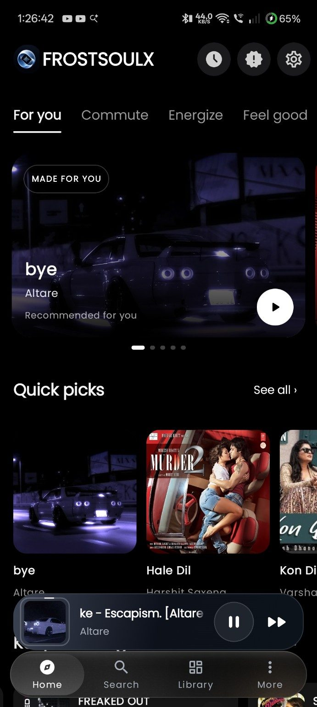
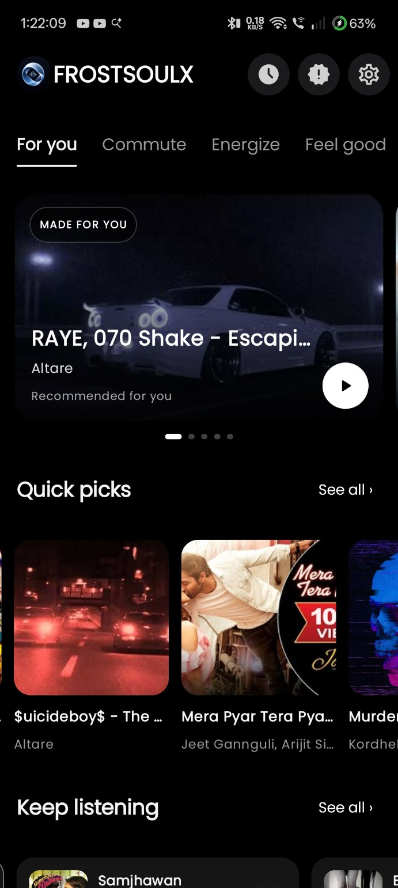
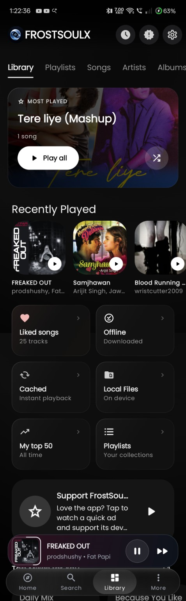
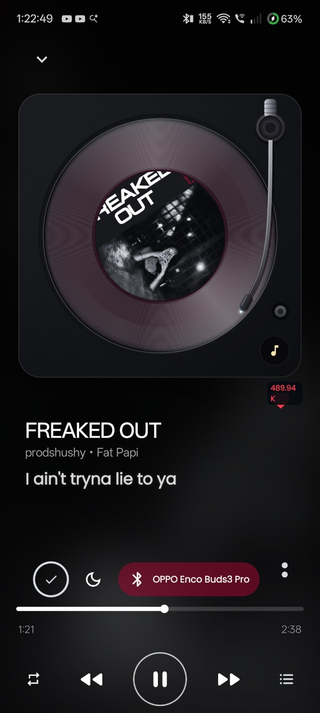
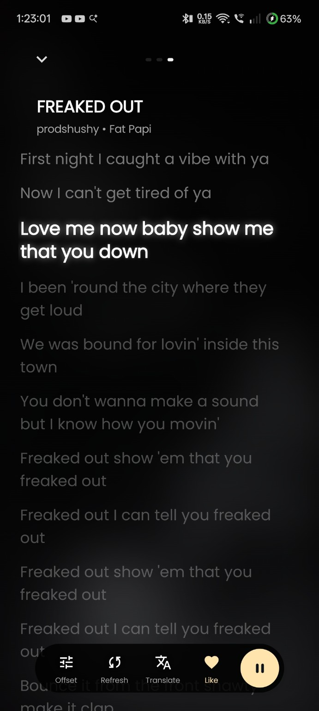
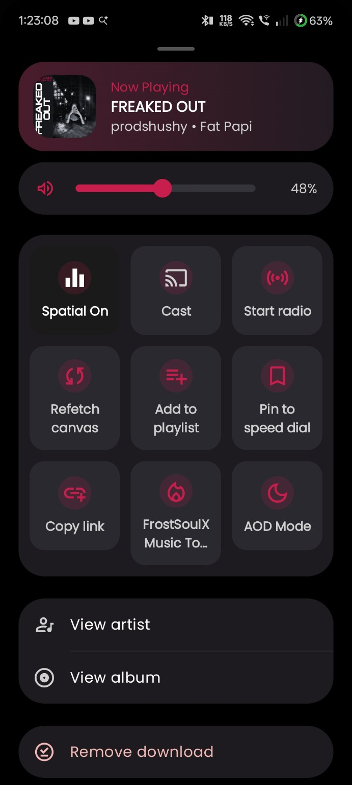
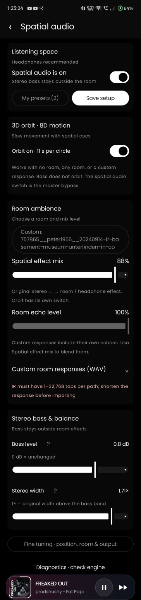
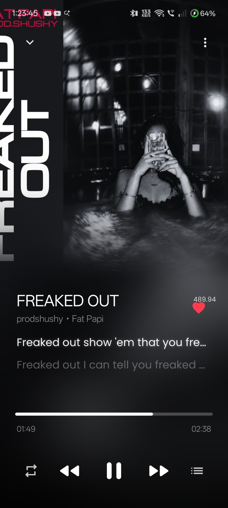
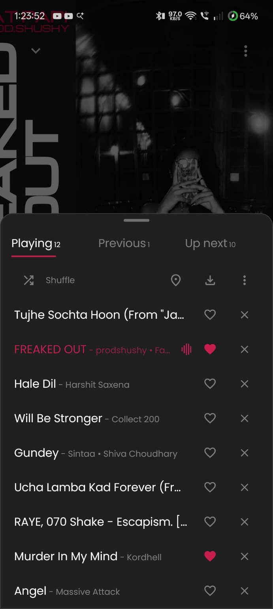
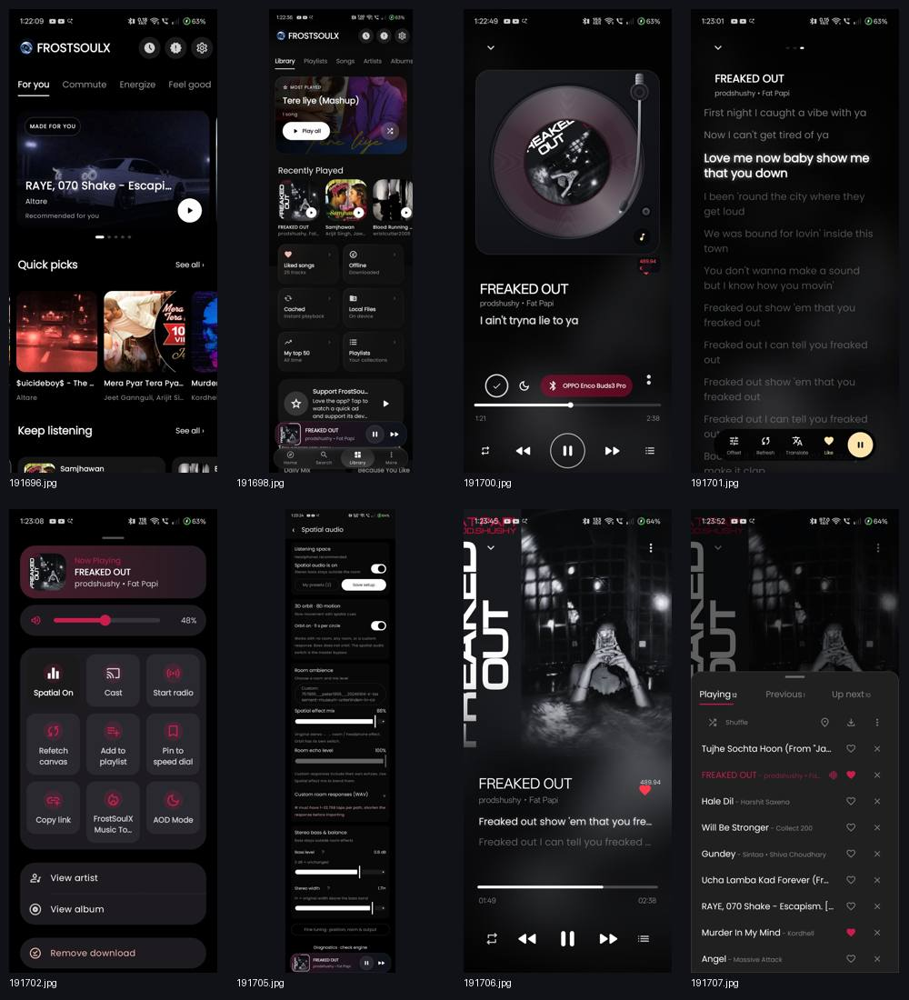

# FrostSoulX

  

<h3 align="center">Your music. Your own atmosphere.</h3>

An artwork-first Android music player with local playback, synchronized lyrics, music discovery, contextual recommendations, and experimental immersive audio.

  <a href="https://frostsoulx.vercel.app/">Project website</a> ·
  <a href="https://github.com/sakuraDev31/frostsoulx/releases/latest">Latest release</a> ·
  <a href="https://github.com/sakuraDev31/frostsoulx/issues">Report an issue</a>

## Home screen

  

FrostSoulX puts the music first: a dark, artwork-led interface, mood-based discovery, quick picks, and playback controls close at hand.

## App screenshots

The screenshots below show distinct parts of the app. Repeated home-screen exports and website/error-page captures are intentionally omitted.

  
  
  

  
  
  

  
  
  

## What it focuses on

- **Artwork-led interface:** a dark visual identity designed around album art.
- **Local music:** play audio stored on your device.
- **Synchronized lyrics:** follow time-aligned lyrics while listening.
- **Discovery:** explore quick picks and contextual recommendations.
- **Immersive audio experiments:** spatial processing and room-response controls are under active development; results can vary by device and setup.
- **Android-first:** built for mobile listening, with a compact mini-player and accessible playback controls.

## Links

- **Website:** https://frostsoulx.vercel.app/
- **Source code:** https://github.com/sakuraDev31/frostsoulx
- **Releases:** https://github.com/sakuraDev31/frostsoulx/releases
- **Issues and feedback:** https://github.com/sakuraDev31/frostsoulx/issues

FrostSoulX is an independent open-source project. See the repository's `LICENSE` file for license terms.
