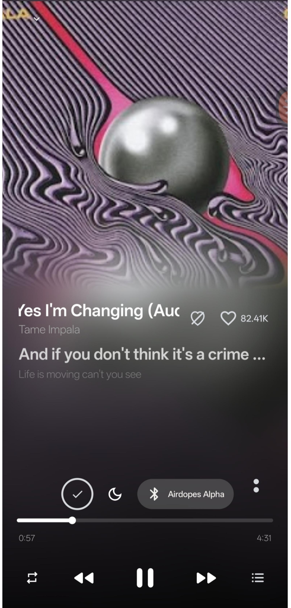
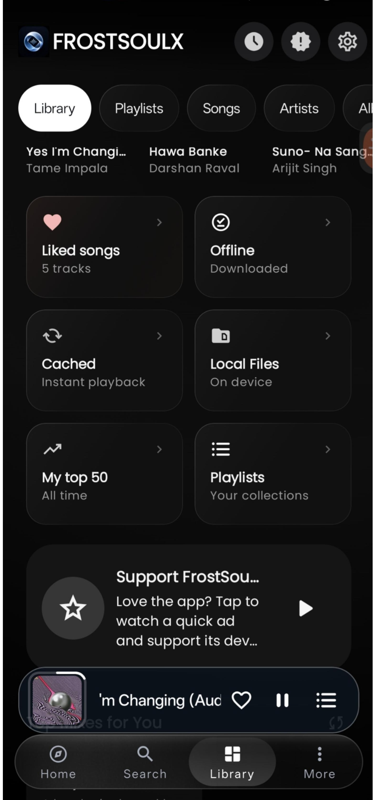
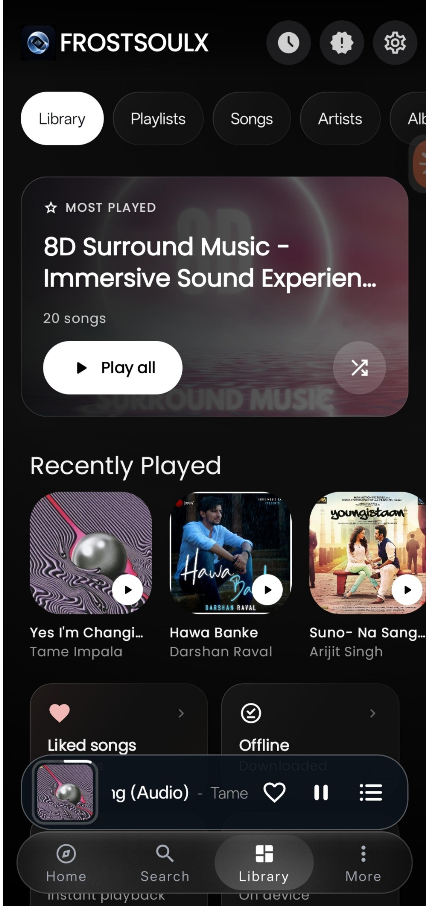
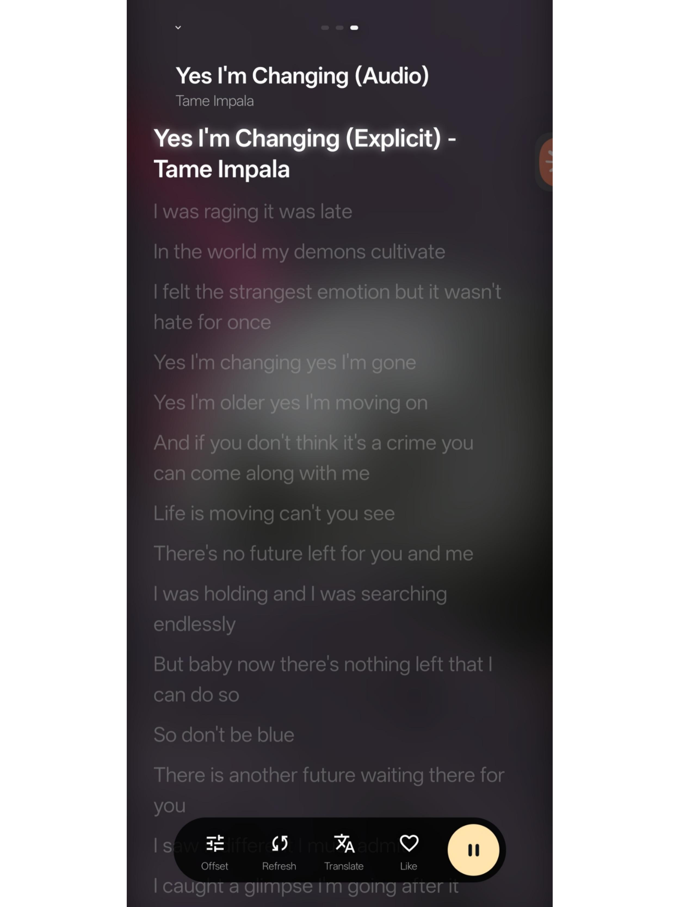
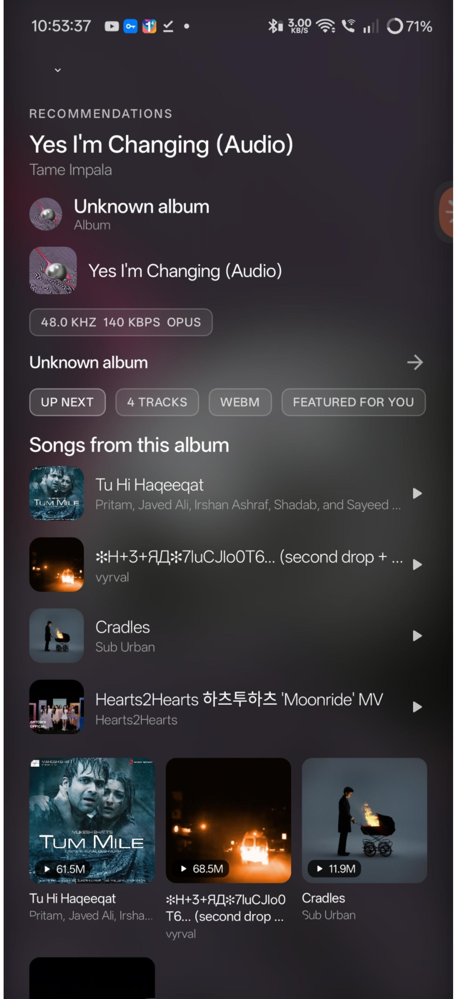

# FrostSoulX

  

<h3 align="center">Your music. Your own atmosphere.</h3>

An artwork-first Android music player with synchronized lyrics, local media, music discovery, contextual recommendations, and experimental immersive audio.

  <a href="https://frostsoulx-docs.vercel.app/">Project website</a> ·
  <a href="https://sakuradev31.github.io/frostsoulx/">GitHub Pages</a> ·
  <a href="https://github.com/sakuraDev31/frostsoulx/releases/latest">Latest release</a> ·
  <a href="https://github.com/sakuraDev31/frostsoulx/issues">Report an issue</a>

## A player built around the artwork

FrostSoulX puts the album cover and the current track at the center of the listening experience. Its dark, adaptive presentation is designed to feel personal without burying the controls.

## Screens from the app

<table>
<tr>
<td align="center" width="33%"> <b>Immersive player</b></td>
<td align="center" width="33%"> <b>Music library</b></td>
<td align="center" width="33%"> <b>Listening history</b></td>
</tr><tr>
<td align="center"> <b>Synchronized lyrics</b></td>
<td align="center"> <b>Discovery</b></td>
<td align="center"> <b>Artwork-led playback</b></td>
</tr>
</table>

## What it focuses on

- **Artwork-led interface:** album art and extracted colors help set the mood.
- **Local music:** play music files stored on your device.
- **Synchronized lyrics:** follow the track with time-aligned lyrics.
- **Discovery:** browse music and explore contextual recommendations.
- **Immersive audio experiments:** spatial processing and room-response controls are under active development; results can vary by device and setup.
- **Android-first:** designed for mobile listening, with a compact mini-player and playback controls.

## Get involved

- **Website:** https://frostsoulx-docs.vercel.app/
- **Source code:** https://github.com/sakuraDev31/frostsoulx
- **Releases:** https://github.com/sakuraDev31/frostsoulx/releases
- **Issues and feedback:** https://github.com/sakuraDev31/frostsoulx/issues

FrostSoulX is an independent open-source project. See the repository's `LICENSE` file for license terms.